# Sorting Station Control – Siemens S7-1500 / TIA Portal V19

A small conveyor-based sorting station program written for a Siemens S7-1500 PLC in TIA Portal V19. The station counts good and defective parts, diverts defective parts, and handles faults with a latched fault code. An operator HMI screen is included.

The project is a Siemens port of an earlier conveyor project built in CODESYS with Structured Text. The same ideas (state machine, reusable function block, counters, lamps, reset logic) were moved to the TIA Portal programming model: OB/FB/DB structure, UDTs, instance data blocks, and tag tables.

## Status

| Item | Status |
|---|---|
| Hardware configuration | Done |
| PLC program (LAD + SCL) | Done, compiles with 0 errors |
| HMI screen (WinCC) | Done, compiles with 0 errors |
| Simulation test in S7-PLCSIM | **Not yet performed** (see [Test plan](#test-plan)) |

The test plan below is documented but has not been executed. Results will be added once simulation is available.

## Features

- State machine in SCL: `Idle`, `Running`, `Fault`
- Reusable motor control FB in LAD with seal-in, stop priority, and interlock input
- UDT-based station data structure shared between PLC and HMI
- Latched, bit-coded fault word (emergency stop, overload, over-temperature, jam)
- IEC timers (`TON`, `TP`), IEC counters (`CTU`), and edge detection (`R_TRIG`)
- Analog input scaling with `NORM_X` and `SCALE_X`
- Startup OB (`OB100`) that puts the station in a known state
- Operator HMI: start, stop, reset, counter reset, state, counters, temperature, fault code

## Tools

- Siemens TIA Portal V19 (STEP 7 Professional, WinCC)
- Target PLC: S7-1500, CPU 1511-1 PN
- Languages: LAD (`FB_Motor`, `OB1`), SCL (`FB_Station`, `OB100`)

## Repository layout

| Path | Content |
|---|---|
| `README.md` | This file |
| `src/FB_Station.scl` | SCL source of the main state machine |
| `src/OB100_Startup.scl` | SCL source of the startup OB |
| `archive/SortingStation_V19.zap19` | Full TIA Portal project archive |
| `docs/images/` | Screenshots used in this document |

To open the project, unzip or retrieve the `.zap19` archive in TIA Portal V19 (`Project > Retrieve`). Opening it in an older version is not possible.

## Hardware configuration

| Slot | Module |
|---|---|
| 1 | CPU 1511-1 PN |
| 2 | DI 16x24VDC BA (digital inputs, start address 0) |
| 3 | DQ 16x24VDC BA (digital outputs, start address 0) |
| 4 | AI 4xU/I ST (analog inputs, start address 64) |

System memory and clock memory bytes are enabled. The 1 Hz clock bit (`%M0.5`) drives the blinking fault lamp.

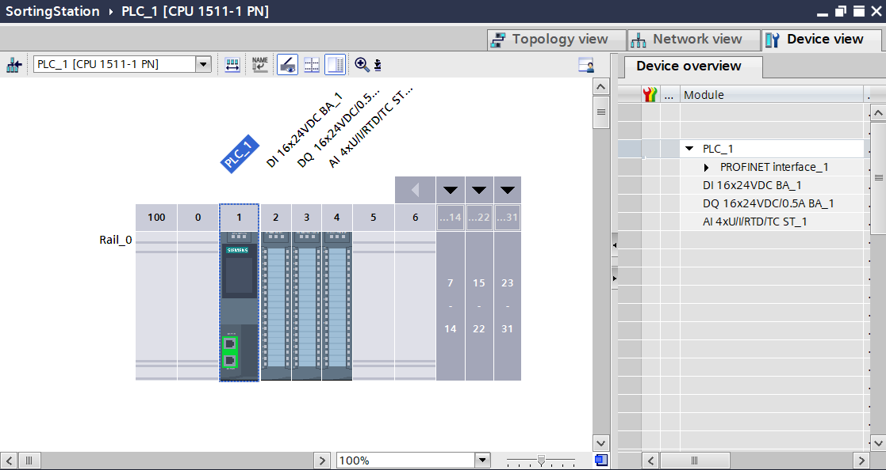

## I/O list

| Address | Tag | Type | Description |
|---|---|---|---|
| %I0.0 | `PB_Start` | Bool | Start pushbutton, NO contact |
| %I0.1 | `PB_Stop` | Bool | Stop pushbutton, NC contact (0 = pressed) |
| %I0.2 | `PB_Reset` | Bool | Alarm reset pushbutton |
| %I0.3 | `ESTOP_OK` | Bool | Emergency stop circuit, 1 = healthy |
| %I0.4 | `S_Entry` | Bool | Part entry sensor |
| %I0.5 | `S_Defective` | Bool | Defective part signal |
| %I0.6 | `Motor_Overload_OK` | Bool | Motor overload relay, NC, 1 = healthy |
| %IW64 | `AI_MotorTemp` | Int | Motor temperature, raw analog value 0..27648 |
| %Q0.0 | `K_Motor` | Bool | Conveyor motor contactor |
| %Q0.1 | `L_Run` | Bool | Green lamp, running |
| %Q0.2 | `L_Fault` | Bool | Red lamp, fault (blinking) |
| %Q0.3 | `L_Idle` | Bool | Yellow lamp, idle |
| %Q0.4 | `Y_Diverter` | Bool | Diverter actuator for rejected parts |
| %Q0.5 | `Horn` | Bool | Alarm horn |

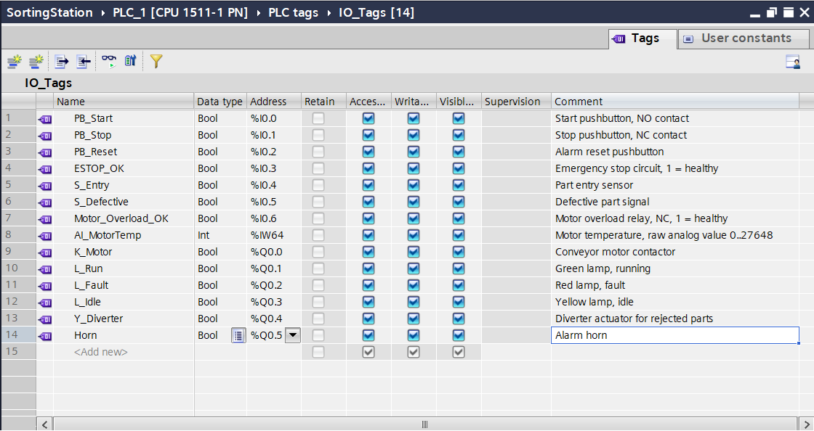

## Program structure

| Block | Type | Language | Purpose |
|---|---|---|---|
| `Main [OB1]` | OB | LAD | Scales the analog input, then calls `FB_Station` |
| `Startup [OB100]` | OB | SCL | Resets state, fault code, and HMI commands at startup |
| `FB_Station` | FB | SCL | State machine, fault handling, sorting, outputs |
| `FB_Motor` | FB | LAD | Motor seal-in with stop priority and permissive |
| `iDB_Station` | Instance DB | – | Instance data of `FB_Station` |
| `DB_Station` | Global DB | – | Station data of type `udt_Station`, shared with the HMI |
| `udt_Station` | UDT | – | Station data structure |

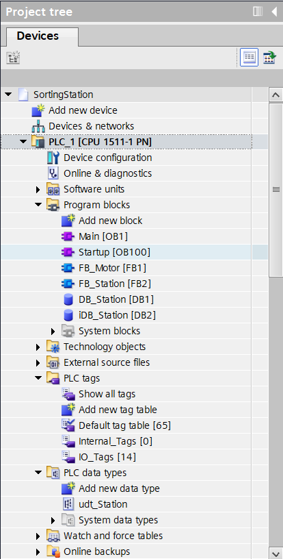

### Station data (`udt_Station`)

| Member | Type | Description |
|---|---|---|
| `State` | Int | 0 = Idle, 1 = Running, 2 = Fault |
| `FaultCode` | Word | Bit-coded latched faults |
| `CntGood` | DInt | Count of good parts |
| `CntReject` | DInt | Count of rejected parts |
| `MotorTemp` | Real | Scaled motor temperature in degC |
| `TempLimit` | Real | Maximum allowed motor temperature (start value 80.0) |
| `HMI_Start` | Bool | Start command from HMI |
| `HMI_Stop` | Bool | Stop command from HMI |
| `HMI_Reset` | Bool | Alarm reset command from HMI |
| `HMI_ResetCnt` | Bool | Counter reset command from HMI |

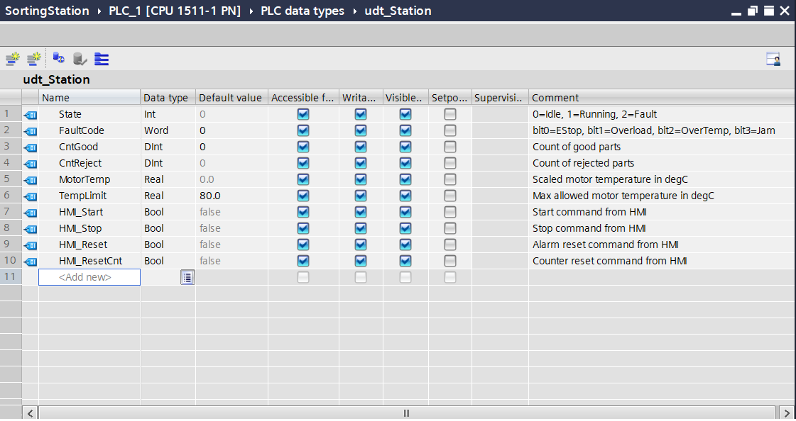

### Fault code bits

| Bit | Fault | Condition |
|---|---|---|
| 0 | Emergency stop | `ESTOP_OK` = 0 |
| 1 | Motor overload | `Motor_Overload_OK` = 0 |
| 2 | Over-temperature | `MotorTemp` > `TempLimit` |
| 3 | Jam | `S_Entry` active for more than 5 s while running |

The fault code is latched. It is cleared by a reset edge, and bits for faults that are still active are set again immediately.

## State machine

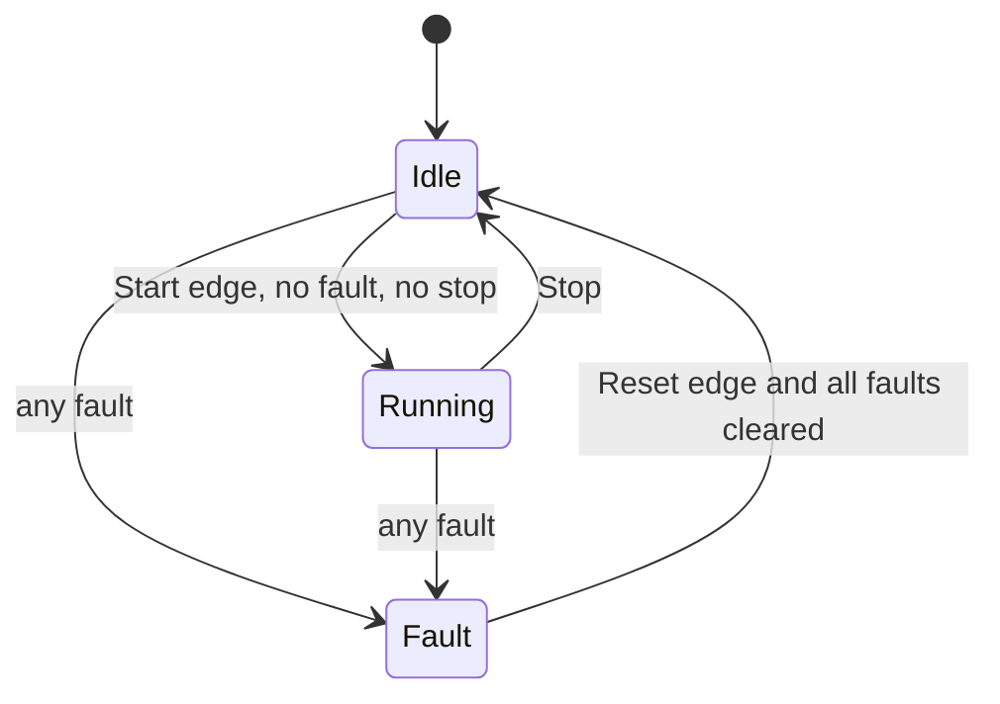

| State | Motor | Green lamp | Yellow lamp | Red lamp | Horn |
|---|---|---|---|---|---|
| Idle | off | off | on | off | off |
| Running | on | on | off | off | off |
| Fault | off | off | off | blinking 1 Hz | on |

### Sorting logic

While the station is in `Running`, each rising edge of `S_Entry` is evaluated once:

- If `S_Defective` is active, `CntReject` increases and the diverter is pulsed for 2 s.
- Otherwise `CntGood` increases.

`S_Defective` must be valid before the rising edge of `S_Entry`.

### Analog scaling

The raw value of `AI_MotorTemp` (0..27648) is normalized with `NORM_X` and scaled with `SCALE_X` to 0..150 degC. The result is stored in `DB_Station.MotorTemp`, which `FB_Station` compares with `TempLimit`.

| Raw value | Temperature |
|---|---|
| 0 | 0 degC |
| 13824 | 75 degC |
| 14746 | about 80 degC |
| 27648 | 150 degC |

### Motor FB (`FB_Motor`)

```
RunMem := (Start OR RunMem) AND NOT Stop AND Permissive
Run    := RunMem
```

`Stop = 1` means a stop is requested. The NC stop pushbutton is inverted at the call site in `FB_Station`. `Permissive` is driven by `State = 1`, so any fault or stop drops the motor immediately.

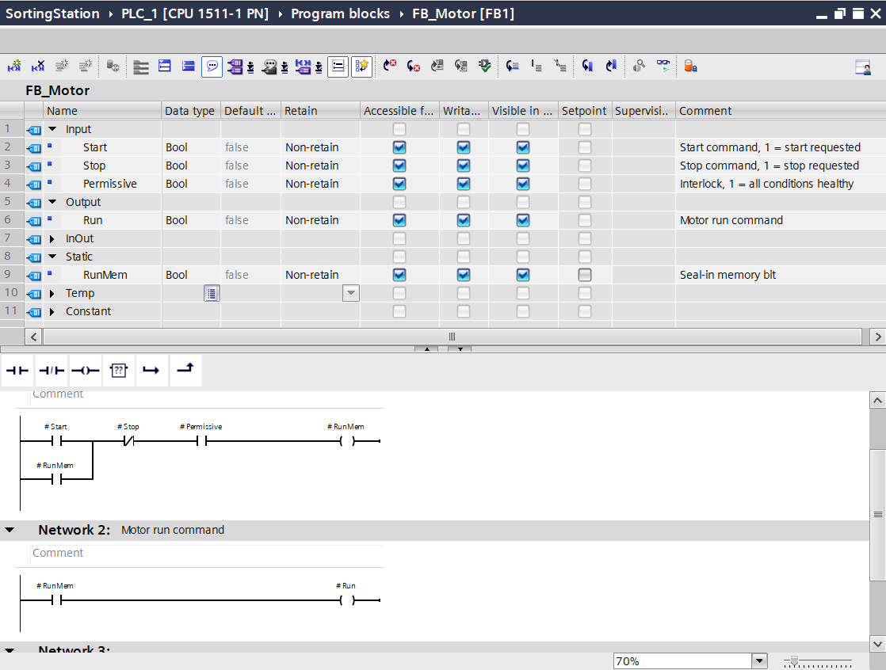

### Main station block (`FB_Station`)

The SCL source is in [`src/FB_Station.scl`](src/FB_Station.scl).

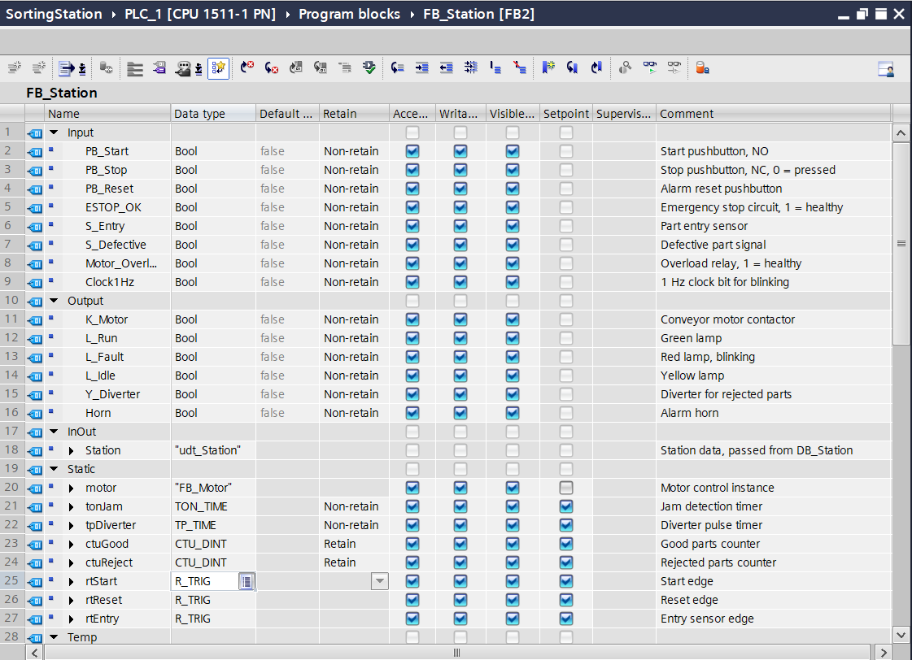

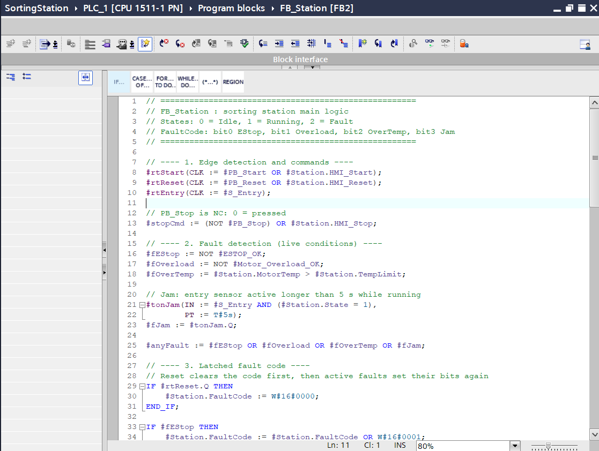

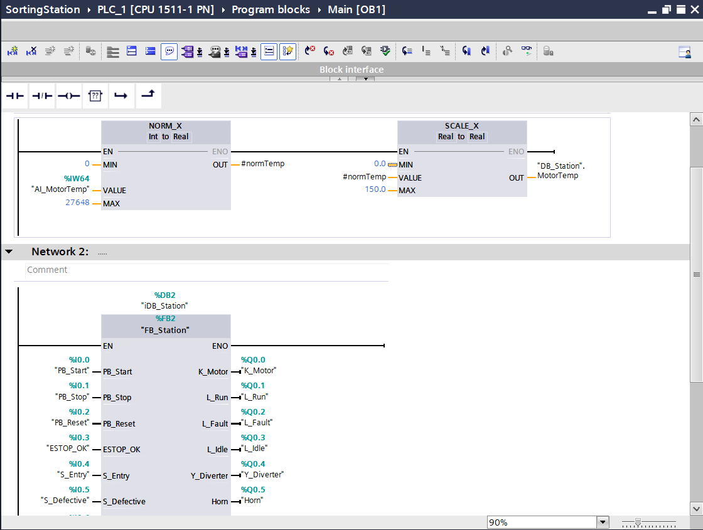

## HMI

The HMI screen is built in WinCC for a SIMATIC Comfort Panel and connects to `PLC_1` over PROFINET/Ethernet. It shows the state, good and rejected counters, motor temperature, and fault code. The buttons `Start`, `Stop`, `Reset`, and `Reset counters` act as momentary buttons (`SetBit` on press, `ResetBit` on release), which is what the PLC logic expects.

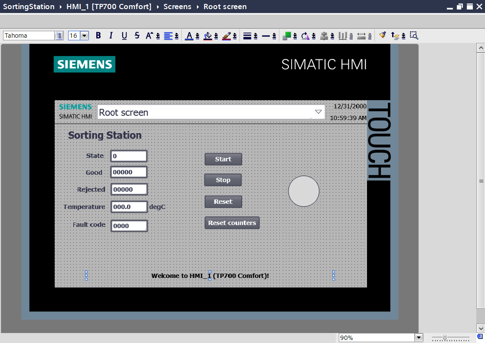

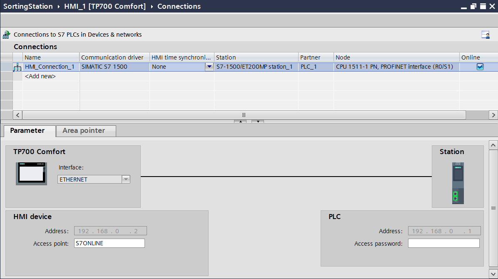

## Test plan

The scenarios below are designed for S7-PLCSIM and have **not been run yet**.

Preconditions in simulation: set `PB_Stop`, `ESTOP_OK`, and `Motor_Overload_OK` to 1 before starting. These three signals use NC wiring, so a value of 0 means the condition is active.

| # | Scenario | Expected result | Status |
|---|---|---|---|
| 1 | Start with no fault | Motor on, green lamp on, state = 1 | Planned |
| 2 | Stop | Motor off, yellow lamp on, state = 0 | Planned |
| 3 | Good part passes (`S_Entry` pulse, `S_Defective` = 0) | `CntGood` + 1 | Planned |
| 4 | Defective part passes (`S_Defective` = 1 before `S_Entry` pulse) | `CntReject` + 1, diverter on for 2 s | Planned |
| 5 | Emergency stop activated | State = 2, motor off, horn on, fault bit 0 set | Planned |
| 6 | Motor temperature above 80 degC | State = 2, fault bit 2 set | Planned |
| 7 | `S_Entry` active for more than 5 s while running | State = 2, fault bit 3 set | Planned |
| 8 | Reset while a fault is still active | State remains 2 | Planned |
| 9 | Reset after all faults are cleared | State returns to 0, fault code cleared | Planned |

## Design notes

- **Retentive counters:** the `CTU` counters in `FB_Station` are retentive. They survive a power cycle and are cleared only with the `Reset counters` HMI button.
- **Interface style:** the station data is passed to `FB_Station` as an `InOut` parameter, so the block is not tied to one specific data block.
- **Clock bit as input:** the 1 Hz clock is an input of `FB_Station`, which keeps the block independent of the memory byte address.
- **Jam detection:** the jam timer runs only while the station is in `Running`. After a jam, the fault stays latched through the state machine and the fault code until a reset.
- **Counter limit:** the counters are `DInt` based. Part counts in the project are far below any limit.
- **Compiler warnings:** the project compiles with 0 errors. Two warnings remain about the PLC protection level and CPU display password, because no access protection was configured for this learning project. A real plant system should configure both.

## Possible extensions

- Run and document the PLCSIM test plan
- Add an alarm list with text messages in the HMI
- Add a PID loop for temperature control
- Move the motor and diverter logic into a shared library

## Author

Bahram Ashrafzadeh, [LinkedIn](https://www.linkedin.com/in/bahram-ashrafzadeh-it/) 
